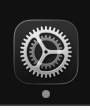
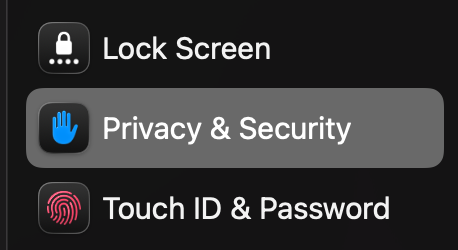
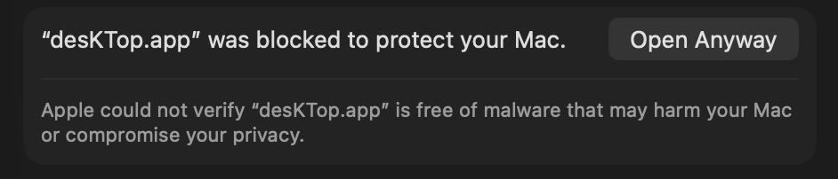

# desKTop

**A digital frame for Tezos art on macOS.**

Enter any wallet address or `.tez` domain. desKTop turns your Mac's screen into a rotating gallery of on-chain art. It renders flat to wallpaper memory, so there are no open browser tabs, no background GPU drain, and no battery hit.

---

### Features

- **Flat-by-Default Architecture**: All generative, SVG, loop, and still artworks are composited headlessly and committed directly into the macOS wallpaper canvas (`NSWorkspace`). Drops to 0.0% CPU between rotations.
- **Zero Keys, Zero Custody**: Read-only ledger queries via TzKT REST API, Objkt GraphQL, and Tezos Domains. No wallet connections, no seed phrases, no signing requests, and no telemetry.
- **Smart Dynamic Galleries**: Save filter criteria or follow any creator's minted oeuvre or collector's holdings with a single click. As new pieces are minted on-chain, they stream into your desktop rotation automatically.
- **Multi-Monitor Hardware Binding**: Screens are keyed to persistent hardware UUIDs (`CGDisplayCreateUUIDFromDisplayID`). Playlists stay assigned to their physical monitors across sleep, wake, and docking.
- **Full Tezos Ecosystem Support**: fxhash (gentk v1, v2, v3 project differentiation), Hic et Nunc / Teia, Versum, Objkt collections, and animated GIF/WebP off-thread frame decoding.
- **Battery & Sleep Guardian**: Automatically pauses rotation timers on sleep to eliminate background battery drain.

---

### Installation

Download the latest release build for macOS (Universal: Apple Silicon & Intel):

- **[Download desKTop.dmg](https://github.com/skullzarmy/desKTop/releases/latest/download/desKTop.dmg)** *(Recommended)*
- **[Download desKTop.zip](https://github.com/skullzarmy/desKTop/releases/latest/download/desKTop.zip)**

Open the `.dmg` and drag `desKTop.app` to your `/Applications` folder.

**Target Platform**: Built for the latest versions of macOS • Universal (Apple Silicon & Intel).

---

### First Launch on macOS (Gatekeeper)

desKTop is free and unencumbered software released into the public domain under [The Unlicense](LICENSE) with zero tracking, zero telemetry, and zero fees.

Because we do not pay Apple $99/year for Apple Developer ID notarization, the latest versions of macOS will ask for your confirmation the first time you run it.

#### Option A: Three-Click Permission

1. **Launch Once**: Double-click `desKTop.app` in your Applications folder. When macOS alerts you that the developer cannot be verified, click **Done** (or **Cancel**).
2. **Open System Settings**: Click the **System Settings** icon in your Dock.
   
   

3. **Navigate to Privacy & Security**: Select **Privacy & Security** in the sidebar and scroll down to the *Security* section near the bottom.
   
   

4. **Click "Open Anyway"**: You will see a prompt stating *"desKTop.app was blocked to protect your Mac."* Click **Open Anyway**, authenticate with Touch ID or your Mac password, and click **Open**.
   
   

You only have to do this once. After this initial approval, desKTop launches instantly from Applications or login items.

#### Option B: Terminal Shortcut (One Command)

Alternatively, strip the quarantine attribute via Terminal before opening:

```bash
xattr -c /Applications/desKTop.app
```

---

### Building from Source

#### Prerequisites
- macOS 14.0+
- Xcode or Swift 6.0+ command line tools

#### Build and Test
```bash
# Clone the repository
git clone https://github.com/skullzarmy/desKTop.git
cd desKTop

# Run the test suite (11 test suites)
./scripts/test.sh

# Bundle the application (.app)
./scripts/bundle.sh

# Generate release bundle (.app, .zip, and styled .dmg)
./scripts/bundle.sh --release
```

The resulting `desKTop.app` bundle and `desKTop.dmg` will be generated in `build/`.

---

### License

This is free and unencumbered software released into the public domain under [The Unlicense](LICENSE).

---

<< a [FAFO~~lab~~](https://fafolab.xyz) joint • [@fafo_lab](https://x.com/fafo_lab) on X >>
